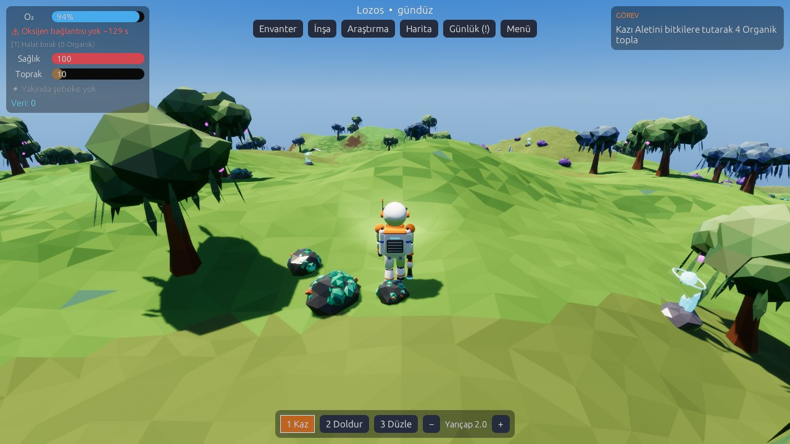
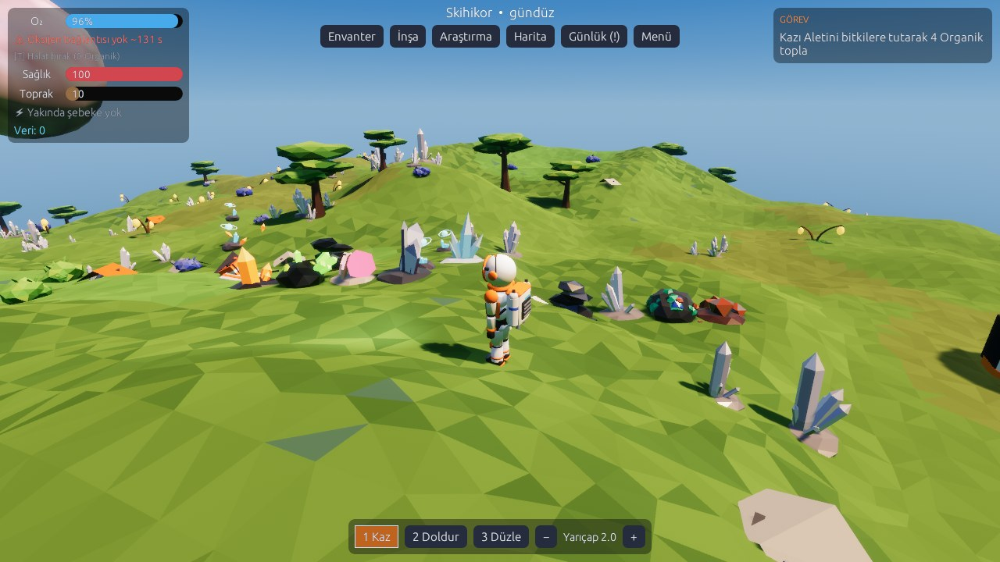
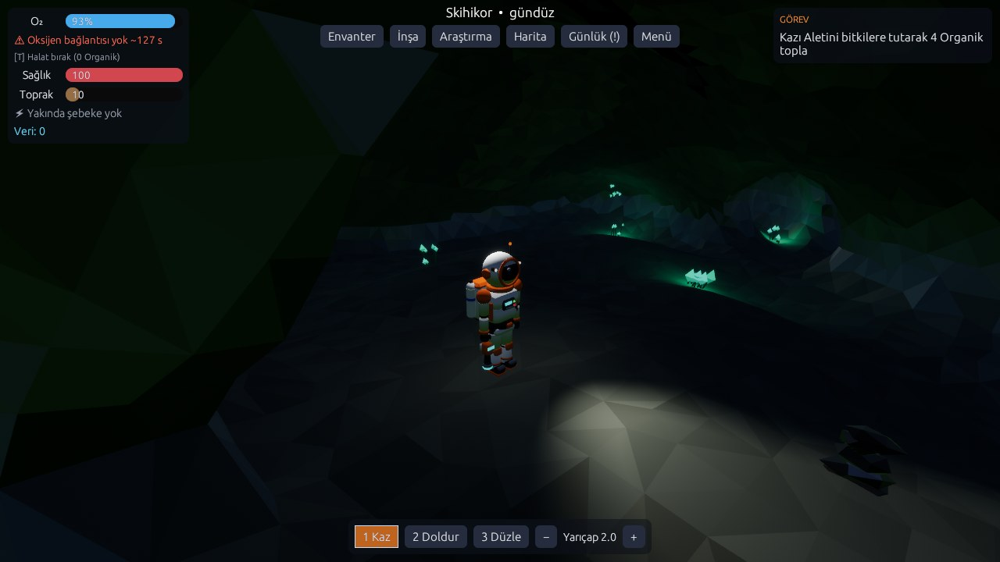

# Lostranout

Yakıt bitti. Yol bitmedi. / The fuel ran out. The road did not.

Rust + Bevy ile yazılmış, voxel gezegenlerde geçen bir 3B keşif, hayatta kalma ve üretim oyunu. Öncü adlı keşif
gemisi fırlatmadan 212 saniye sonra yakıtını kaybeder, yüzyıllarca sürüklenir ve bilinmeyen bir
yıldız sistemine düşer. Amaç: sıfırdan gelişip yıldızlararası bir gemi inşa etmek.

- Tamamen prosedürel: yıldız sistemi, gezegenler, isimler, kaynak dağılımı, bitki türleri.
  Her tohumda oyunun bitirilebilir olduğu testlerle doğrulanır.
- Voxel gezegenler: kazılabilir, doldurulabilir, düzlenebilir küresel arazi, mağaralar, maden damarları.
- Karakter ve bazı yapılar proje betikleriyle Blender'da, bitkiler, kristaller ve enkazlar kodla üretilir; dışarıdan hazır varlık kullanılmaz.
- Katmanlı mağaralar, Öncü'nün enkazları, derinliğe ve gezegen uzaklığına göre artan tehlikeler.
- Türkçe / İngilizce (menüden değişir).





## Hazır derlemeler (`dist/`)

| Dosya | Durum |
|---|---|
| `lostranout-linux-x86_64` | Linux Mint 22 üzerinde sınandı (60 FPS, GTX 1650) |
| `lostranout-android-arm64.apk` | Galaxy A36'da önceki sürüm sınandı; mağara, tehlike ve görsel güncellemeli bu sürüm telefonda henüz denenmedi |
| `lostranout-windows-x86_64.exe` | Çapraz derlendi; bir Windows makinesinde **çalıştırılıp denenmedi** |

## Oynanış

1. Kazı Aleti ile bitkilerden organik, kristal kümelerinden ve yer altı damarlarından maden topla.
2. Eritme Ocağı → Araştırma İstasyonu → Üretim Tezgahı → Kimya Laboratuvarı kur.
3. Mavi ışıklı numuneleri ve turuncu kara kutu parçalarını Araştırma İstasyonunda Veri'ye çevir,
   Veri ile teknoloji aç. Kara kutu parçaları ve MİRA'nın günlüğü hikâyeyi anlatır.
4. Mekik inşa et, yakıt üret, diğer gezegenlere uç: titanyum, lityum, uranit ve helyosit oralarda.
5. Yıldız Tersanesini kur, gemi parçalarını teslim et ve fırlat. Sonraki yıldız sistemi seni bekliyor.

Oksijen yalnızca Kapsül, Mekik, Tersane ve Oksijen İstasyonlarının yakınında dolar. Üsten
uzaklaşmak için Oksijen Halatı direkleri bırak: canlı bir zincirle kaynağa bağlı direğin yanında
nefes alırsın, zincir koparsa uyarı çıkar.
Makineler güç ister (Biyo-Jeneratör, Güneş Paneli, Batarya, Radyoizotop Jeneratör) ve yalnızca
kabloyla bağlı oldukları şebekeden beslenir. Yakına kurulan yapı kendiliğinden kablolanır;
uzak bağlantılar için Güç Direği kullan, yapı panelinden kablo tak / sök.
Üssün, sen başka gezegendeyken de üretmeye devam eder.

Derin mağaralar ve uzak gezegenler tehlikelidir. Bayılırsan MİRA sırt çantandakileri düştüğün
yerde bırakıp seni üsse taşır; eşyalarını orada turuncu işaretli paketten geri alabilirsin.

## Kontroller

| | Klavye / fare | Dokunmatik |
|---|---|---|
| Yürü / koş | WASD, Shift | sol alt bölgede sürükle (sanal joystick) |
| Zıpla / jetpack | Boşluk | ZIPLA düğmesi |
| Kamera | sağ tık sürükle, tekerlek | ekranı sürükle, + / - |
| Kazı aleti | sol tık (1 kaz, 2 doldur, 3 düzle, Z/X çap) | "ALET: AÇIK" iken araziye dokun |
| Etkileşim | E | turuncu yapı adı düğmesi |
| Oksijen halatı bırak | T | Halat düğmesi |
| Tablet | Tab envanter, B inşa, R araştırma, M harita, J günlük | üst çubuk |
| Duraklat | Esc | Menü |

Oyun; 75 saniyede bir, pencere kapatılırken ve Android'de arka plana alınırken kendiliğinden kaydeder.

## Derleme

```bash
cargo run --release     # Linux (X11)
cargo test --lib        # isimler, bitirilebilirlik, üretim zinciri, güç ağı, mağaralar, tehlikeler, hikâye
```

Windows (Linux üzerinden çapraz derleme, zig ile):

```bash
pip install ziglang && cargo install cargo-zigbuild
rustup target add x86_64-pc-windows-gnu
cargo zigbuild --release --target x86_64-pc-windows-gnu
```

Windows üzerinde doğrudan `cargo build --release` yeterlidir.

Android (APK):

```bash
cargo install cargo-apk && rustup target add aarch64-linux-android
export ANDROID_HOME=~/Android/Sdk ANDROID_NDK_ROOT=~/Android/Sdk/ndk/27.0.12077973
cargo apk build --release --lib
adb install -r target/release/apk/lostranout.apk
```

Notlar:

- Derleme çıktıları proje içindeki `target/` klasörüne yazılır (birkaç GB); `CARGO_TARGET_DIR` ile başka yere alınabilir.
- APK, `android/debug.keystore` (parola `android`) ile imzalanır. Yayınlamadan önce kendi anahtarınla değiştir.
- Kayıt dosyası: Linux `~/.local/share/lostranout/`, Windows `%APPDATA%\lostranout\`,
  Android uygulamanın iç depolaması.

## Bilinen eksikler

- Ses yok (bu makinede ALSA geliştirme başlıkları kurulu olmadığı için ses desteği derlenmedi).
- Android'de ön kamera çentiğinin olduğu kenarda ince siyah bir şerit kalır.
- Telefonda gölgeler kapalıdır (performans için).

## Kaynak düzeni

| Dosya | İçerik |
|---|---|
| `src/galaxy.rs`, `src/names.rs` | yıldız sistemi, gezegen, flora ve isim üretimi |
| `src/voxel.rs`, `src/terrain.rs` | yoğunluk alanı, katmanlı mağaralar, damarlar, mesh, akışlı yükleme |
| `src/decor.rs`, `src/props.rs`, `src/nature.rs` | bitkiler, maden kristalleri, enkaz ve hurdalar |
| `src/meshgen.rs`, `src/models.rs`, `tools/blender/` | prosedürel ve Blender'da üretilen modeller |
| `src/sky.rs` | gökyüzü, güneş, ay, atmosfer, ortam ışığı |
| `src/hazards.rs` | tehlikeler, bayılma paketleri |
| `src/network/` | güç kabloları ve oksijen halatları |
| `src/items.rs` | eşyalar, tarifler, yapılar, teknoloji ağacı |
| `src/story.rs` | giriş, günlük, görevler, sistem bölümleri, sonlar (TR/EN) |
| `src/world.rs`, `src/player.rs`, `src/gameplay.rs` | sahne, kontrol, simülasyon |
| `src/ui.rs` | egui arayüzü |
| `src/debug.rs` | otomatik duman testleri için bot |

### Otomatik deneme (geliştirici)

Ortam değişkenleriyle oyun menüsüz başlatılıp betikle sürülebilir; pencere odağı çalmaz:

```bash
LOSTRANOUT_HOME=/tmp/lr LOSTRANOUT_AUTOSTART=5 LOSTRANOUT_BOT=dig cargo run
```

`LOSTRANOUT_BOT`: `walk`, `dig`, `fill`, `flat`, `mouse`, `place`, `travel`, `finale`.
`LOSTRANOUT_CHEAT=1` tüm eşyaları ve 9000 Veri verir, `LOSTRANOUT_UI=inv|build|research|map|journal|pause`
bir paneli açar, `LOSTRANOUT_TIME=250` oyunu o saniyeden (ör. gece) başlatır, `LOSTRANOUT_DEST=3`
yolculuk hedefini seçer.

## Lisanslar ve üçüncü taraf içerik

Oyundaki tüm modeller, gezegenler, isimler, hikâye ve arayüz bu proje için üretildi; başka bir
oyundan, filmden ya da kitaptan içerik, isim veya varlık kullanılmaz. Rastgele isim üreticisi,
başka eserlerden tanınmış gezegen ve yer adlarını üretmemek için bir yasak liste kullanır.

Kullanılan açık kaynak bileşenlerin (Bevy, egui ve diğer Rust kütüphaneleri; MIT / Apache-2.0 /
BSD / Zlib / ISC / CC0) ve oyuna gömülü fontların (Ubuntu Light: Ubuntu Font Licence 1.0, Hack:
MIT / Bitstream Vera, Noto Emoji: SIL OFL 1.1, emoji-icon-font: MIT) tam listesi ve lisans metinleri
[THIRD_PARTY_LICENSES.txt](THIRD_PARTY_LICENSES.txt) dosyasındadır. Bu dosya oyunun dağıtılan her
kopyasıyla birlikte verilmelidir (`dist/` içinde ve APK'nın içinde bulunur).

Modeller `tools/blender/` betikleriyle Blender'da üretilir; Blender yalnızca araçtır, oyuna dahil değildir.
